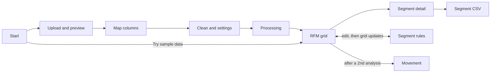

# Doc 3 · App flow

Status: approved 2026-10-23.

11 screens and 5 journeys, built around one intent: "Tell me who to email this week, and why." No journey involves an account, a payment or a server.

## Actors

| Actor | What they do |
| --- | --- |
| Store owner (primary) | Uploads exports, reads the grid, edits rules, exports segments, compares months |
| Agency or freelancer | Same, for several client stores, one project per client |
| Developer (later) | Uses the `core` package directly; no screens |

## Journeys

1. **Try it:** Start → "Try sample data" → Grid → Segment detail → Export.
2. **First real analysis:** Start → Upload → Preview → Map columns → Clean and settings → Processing → Grid → Segment detail → Export.
3. **Change the rules:** Grid → Segment rules → edit a cell → Grid updates.
4. **Monthly check:** Start → open saved project → Upload new export → Processing → new snapshot → Movement → Export movers.
5. **Keep or remove my data:** Project and data → Save project file, or Delete all data.

## Screen inventory

| Screen | The one question it answers | Primary action | Data shown | Empty / loading / error states |
| --- | --- | --- | --- | --- |
| Start | How do I begin? | Upload orders | Saved projects on this device; one-line privacy promise; "Try sample data" | Empty: upload and sample shown large. Error: storage unavailable, warn nothing will be saved |
| Upload and preview | Is this the right file? | Continue | File name, row count, first 20 rows | Loading: streaming row counter. Error: unreadable file, with line number and fix |
| Map columns | Which column is which? | Confirm columns | Required (customer, order ID, date, amount), optional (email, status), preset guesses | Error: required field unmapped, highlighted with reason |
| Clean and settings | Which orders count? | Run analysis | Status filters, gross/net, refunds, analysis date, lookback, scoring method, excluded counts | Warning: over 50% of rows excluded |
| Processing | How long will this take? | Cancel | Progress bar, rows read, customers found | Error: too large or failed, with diagnostics copy |
| RFM grid | Where are my customers and revenue? | Open segment | 11 segments: count, share of customers, share of revenue; scoring summary | Never empty (sample offered). Warning: under 5 customers |
| Segment detail | Who is in this segment, and what should I do? | Export | Plain-words definition, suggested action, sortable customer list with R, F, M | Empty: "No customers here right now" with meaning |
| Segment rules | Which scores belong to which segment? | Save rules | Editable map, coverage check, Reset to default | Error: cell unassigned or doubly assigned, save blocked |
| Movement | Who moved since last time? | Export | From-to table between two snapshots, biggest flows first | Empty: only one snapshot, explains how to make a second |
| Project and data | What is saved on this device? | Save project file | Snapshots, settings, storage used | Destructive: Delete all data |
| How scores work | How are scores calculated? | — | Method, breakpoints, bin sizes, limits of RFM | — |

Diagnostics is a panel reachable from every error, not a screen.

## States

Every interactive element has hover, active, focus, loading, empty and error states. Long values truncate at 40 characters with full text on focus or hover; exports always contain the full value.

## Onboarding

Three questions on first upload, each pre-filling later steps: which platform the file came from (selects the preset); per-order or per-line-item export; analysis date (default: day after the latest order). The grid is never empty: sample data is one click away.

## Segment guidance

Each segment shows a short suggested action, paraphrased from published RFM guides (Putler, DataHub Pro, Flyde). Examples: reward Champions without discounts; send At risk and Can't lose them a personal win-back; stop paying to reach Lost customers.

## Friction and closure

- **Delete all data:** dialog stating exactly what is deleted; user types DELETE to confirm.
- **Segment rule edits:** Undo bar for 10 seconds after each change.
- **Export:** toast with file name and row count.

## Same verb everywhere

| Action | Verb | Never |
| --- | --- | --- |
| Get a CSV out | Export | Download, Save as |
| Remove data | Delete | Remove, Clear, Trash |
| Start scoring | Run analysis | Calculate, Score |
| Store a project | Save project | Keep, Store |

Checkout, payment, trial and cancellation flows do not apply (free tool, no accounts).
