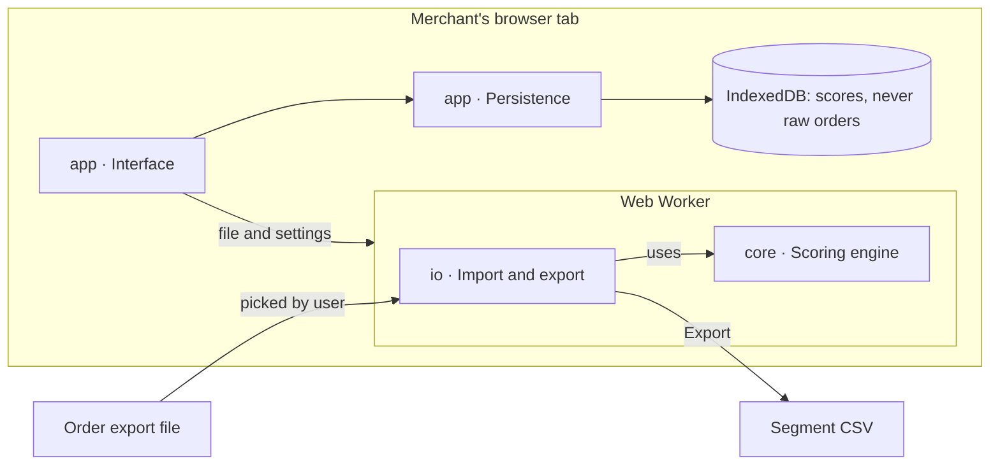

# Doc 2 · Technical Requirements Document (TRD)

Status: approved 2026-10-23. Decisions are recorded in `/docs/adr/`.

The app is a static, local-first web app: a TypeScript scoring engine plus a React interface, running entirely in the browser with no backend.

## 1. Architectural drivers

- **Functional requirements:** PRD stories 1–9.
- **Business constraints:** one maintainer; $0 running budget; MIT open source; usable by non-programmers.
- **Regulatory:** customer data is personal data under GDPR. Processing only on the merchant's device keeps the project from ever receiving it. Not legal advice.
- **Technical constraints:** static hosting only; current desktop Chrome, Edge, Firefox and Safari; no secrets anywhere.

## 2. Driving characteristics

| Characteristic | Plain meaning |
| --- | --- |
| Privacy | Order data never leaves the device |
| Correctness and auditability | Every score and segment can be explained and reproduced |
| Performance | Large files processed without freezing the page |
| Usability | A non-technical owner reaches the grid unaided |
| Testability | The engine is fully testable without a browser |
| Portability | Works with any platform's export through column mapping |
| Availability | Works offline after first load |

## 3. Measurable targets

Measured in the browser on a reference mid-range laptop defined in M1.

| Measure | p50 | p95 |
| --- | --- | --- |
| Score 100,000 order rows (parse to grid) | under 3 s | under 6 s |
| Score 1,000,000 order rows | under 30 s | under 60 s |
| Grid update after a segment-map edit | under 100 ms | under 300 ms |
| UI frame during scoring | never blocked over 100 ms | — |

## 4. Scale estimate

| Step | Calculation | Result |
| --- | --- | --- |
| Largest ICP store | 50,000 customers (PRD assumption) | 50,000 |
| Orders per customer | assume an average of 3 | 150,000 order rows |
| Line-item exports | assume 2 lines per order | 300,000 rows |
| Design target | one order of magnitude of headroom, rounded | 1,000,000 rows |
| Raw file size | 1,000,000 × an assumed 300 bytes per row | about 300 MB |

The file must be streamed row by row and reduced to one record per customer as it is read; the whole file is never held in memory. All inputs are assumptions to check against real exports.

## 5. Architecture style and components

Modular monolith in the browser, split by workflow. The engine sits at the centre and knows nothing about files, React or storage.



| Module | Package | Owns |
| --- | --- | --- |
| Import | `io` | Streaming CSV/XLSX parsing, encoding and delimiter detection |
| Mapping and cleaning | `core` | Column presets, row filters, identity merge by email or ID |
| Scoring | `core` | R, F, M values and 1–5 scores |
| Segmentation | `core` | The 125-cell segment map and its validation |
| Snapshots and movement | `core` | Comparing two scored snapshots |
| Export | `io` | Safe CSV writing |
| Persistence | `app` | Local storage and project files |
| Interface | `app` | Screens, worker orchestration |

## 6. Background work

Parsing and scoring run in a Web Worker. The worker posts progress every 250 ms or 50,000 rows. Anything expected to take over 1 s shows a progress bar with Cancel.

## 7. Engine interface

```typescript
type OrderRow = { customerKey: string; orderId: string; orderedAt: Date; amount: number; status?: string };
type ScoringConfig = { analysisDate: Date; lookbackDays?: number; method: 'quantile' | 'fixed';
  fixedBreaks?: { r: number[]; f: number[]; m: number[] }; amountBasis: 'gross' | 'net'; subtractRefunds: boolean };
type CustomerScore = { customerKey: string; recencyDays: number; frequency: number; monetary: number;
  r: 1|2|3|4|5; f: 1|2|3|4|5; m: 1|2|3|4|5; segmentId: string };

aggregate(rows: AsyncIterable<OrderRow>, cfg: ScoringConfig): Promise<CustomerAggregate[]>;
score(customers: CustomerAggregate[], cfg: ScoringConfig): ScoreResult;
applySegments(scores: ScoreResult, map: SegmentMap): CustomerScore[];
validateMap(map: SegmentMap): ValidationResult; // exactly one segment per R×F×M cell
compare(before: Snapshot, after: Snapshot): MovementMatrix;
```

## 8. Scoring specification (business rules)

1. **Order, not line item.** Rows are grouped by order ID first; a 3-line order counts once.
2. **Recency** = whole days between the analysis date and the customer's latest order. Default analysis date: the day after the latest order in the file; the user can set it to today.
3. **Frequency** = number of distinct orders in the lookback window (default: all data).
4. **Monetary** = total order amount in the window, gross or net, refunds optionally subtracted.
5. **Scores 1–5 by quantile breakpoints.** Compute the 20th, 40th, 60th and 80th percentiles of customers' values. Score = 1 + number of breakpoints strictly below the value. Recency is reversed so the most recent customers get 5. Equal values always get equal scores, so bins can be uneven; the app shows each bin's size.
6. **Frequency defaults to fixed breaks** of 1, 2, 3, 4–5 and 6+ orders, because quantile bins collapse when one-time buyers dominate. Switchable to quantiles.
7. **Fixed thresholds** are available for all three dimensions.

score(v) = 1 + #{ b ∈ {p20, p40, p60, p80} : b < v }

## 9. Tech stack

Exact versions and licenses: ADR-0006.

| Layer | Choice |
| --- | --- |
| Language | TypeScript |
| UI | React |
| Build | Vite |
| Styling | Tailwind CSS with a replaced palette |
| CSV parsing | Papa Parse |
| XLSX parsing | Open (ADR-0006) |
| Local storage | IndexedDB via `idb` |
| Tests | Vitest, fast-check, Playwright |
| Repo | pnpm workspaces: `core`, `io`, `app` |
| Fonts | Geist and Geist Mono, bundled locally (SIL OFL 1.1) |
| Hosting | GitHub Pages |

## 10. Auth and permissions

No accounts. Security rests on a strict Content-Security-Policy: `connect-src 'self'`, no third-party scripts or fonts. A CI test fails if any build file references an external host.

## 11. Reliability and failure modes

| Component | How it fails | What the user sees | What the app does |
| --- | --- | --- | --- |
| Import | File too big for memory | "This file is too large for your browser" with rows reached | Stops the worker, keeps the UI alive, suggests filtering by date |
| Import | Unreadable encoding or format | Which line failed and why | Offers encoding and delimiter override |
| Scoring | Fewer than 5 customers | Explanation that scores need more customers | Blocks scoring |
| Persistence | Browser storage full or cleared | Warning on save | Offers project file download |
| Worker | Crash | "Something went wrong" plus a copyable diagnostic | Restarts the worker |

## 12. Observability

No telemetry or analytics. A local diagnostics panel shows app version, browser, row counts, timings and the last error, with a copy button for GitHub issues. It contains no customer data.

## 13. Deployment and environments

- Development: local Vite dev server.
- Preview: each pull request builds and is checked in CI.
- Production: GitHub Pages, deployed only from a tagged release on `main` after maintainer approval.
- Releases: semantic versions; rollback = redeploy the previous tag.

## 14. Test strategy

| Level | What it proves |
| --- | --- |
| Unit (`core`) | Scoring rules, ties, reversed recency, map validation, movement counts |
| Golden fixtures | Putler's 15-customer example (hand-checked first) plus edge-case files |
| Property tests | One segment per customer; scores 1–5; totals match before and after |
| Integration (`io` + `core`) | Each preset parses its anonymised sample |
| Security | Formula cells escaped on export; no external hosts in the build |
| End-to-end | Sample data to exported CSV in a real browser |
| Performance | 100k-row benchmark in CI fails the build above the p95 target |

## 15. Risks (impact × likelihood, 1–3 each; 6 or 9 is high)

| Risk | Impact | Likelihood | Score |
| --- | --- | --- | --- |
| Browser memory limits on large files | 3 | 2 | 6 (high) |
| Platform export formats change | 2 | 3 | 6 (high) |
| Segment defaults disputed | 2 | 2 | 4 |
| Dependency abandoned or license changes | 2 | 2 | 4 |
| RFM misunderstood as prediction | 2 | 2 | 4 |
